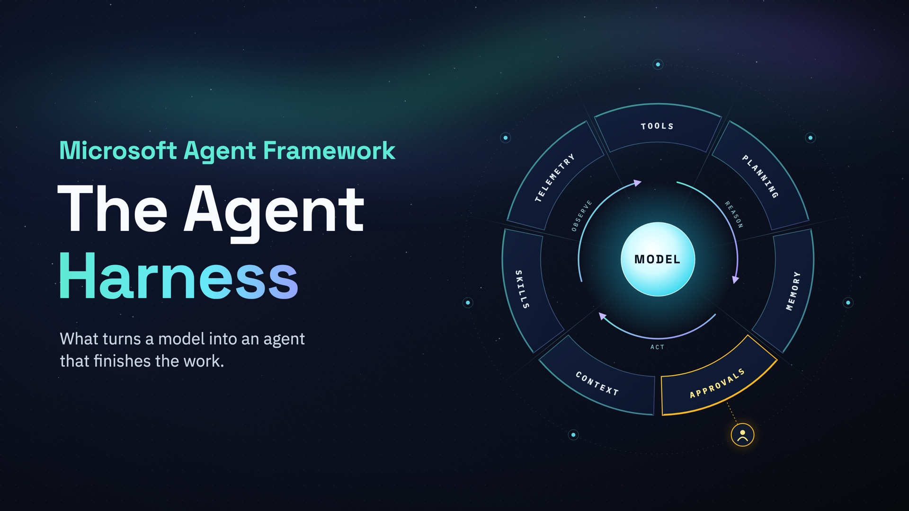

# Night Shift: a Microsoft Agent Framework Harness demo in Python



Night Shift is the overnight operations agent of Northwatch Energy, a fictional operator of about 400 solar and
battery sites across the Nordics. Between 22:00 and 06:00 it works the alert queue of the network operations
center. It reads the runbooks, runs diagnostics, restarts what is safe to restart, asks a human before anything
risky, writes the shift report and leaves notes for the next night.

The agent is built with one call to `create_harness_agent` from
[Microsoft Agent Framework](https://github.com/microsoft/agent-framework) 1.24.0. This repository shows, with
working code and measured results, what the harness adds to a language model with tools. The accompanying
article explains the concept, Microsoft's release and the results:
[The Agent Harness, Explained](article/the-night-shift-agent-harness.md).

Everything the agent touches is simulated in [`nightshift/world.py`](nightshift/world.py), so runs are
deterministic, have no side effects and can be scored against the ground truth in [`scenarios/`](scenarios/).

## What the harness does here

| Harness capability | How Night Shift uses it |
| --- | --- |
| Tool calling loop | Seven Northwatch tools in [`nightshift/tools.py`](nightshift/tools.py) |
| Two instruction layers | A shared operating standard plus the NOC persona, in [`nightshift/instructions.py`](nightshift/instructions.py) |
| Todos and plan/execute modes | One todo per alert. The agent plans first and waits for `/go` |
| Bounded looping | Keeps working while todos remain, at most 12 passes per run |
| Tool approval | Restarting a device and dispatching a technician always stop for a human |
| Auto-approval rules | Reading the workspace and writing under `reports/` never interrupt the operator |
| File memory | `site-notes.md` is shared by every shift through a stable scope |
| File access | The shift report lands in `workspace/reports/` |
| Agent Skills | Four runbooks in [`skills/`](skills/), loaded only when an alert needs them |
| Compaction | Token budgets switch on context-window management |
| OpenTelemetry | Every model call, tool call and agent run is a span, and the evaluation counts them |

## Quick start

You need Python 3.11 or later, the Azure CLI and access to a model. A Microsoft Foundry project is the
recommended setup.

1. Clone the repository and install the dependencies.

   ```bash
   git clone https://github.com/mcekikj/nightshift-ms-harness.git
   cd nightshift-ms-harness
   uv venv -p 3.12 && uv pip install -r requirements.txt
   source .venv/bin/activate
   ```

   Without uv, create the environment with `python3.12 -m venv .venv` and install with
   `.venv/bin/pip install -r requirements.txt`.

2. Copy the example settings, fill in your provider and sign in.

   ```bash
   cp .env.example .env
   az login
   ```

3. Run the first night shift.

   ```bash
   python run_shift.py --scenario shift-01
   ```

The agent reads its notes, lists the alerts, writes a plan and waits. Type `/go` to let it work through the queue.
Each risky action stops at a prompt, where you answer `y` to approve, `n` to deny, `t` to always approve that tool
or `a` to always approve those exact arguments.

### Choosing a model provider

Three providers are wired in [`nightshift/clients.py`](nightshift/clients.py). Choose one with
`NIGHTSHIFT_PROVIDER` in `.env`.

- `foundry` uses a Microsoft Foundry project (`FOUNDRY_PROJECT_ENDPOINT`, `FOUNDRY_MODEL`). It is the recommended
  option, and it also enables Foundry tracing and hosting.
- `azure-openai` uses an Azure OpenAI resource (`AZURE_OPENAI_ENDPOINT`, `AZURE_OPENAI_DEPLOYMENT`) with Entra ID.
- `openai` uses OpenAI directly (`OPENAI_API_KEY`, `OPENAI_CHAT_MODEL_ID`).

Use a current, capable model. The harness adds instructions, todos, modes and skills to your prompt, and small or
older models follow them less reliably. The results in the article come from `gpt-6-luna` on a Foundry project.

Give the deployment some headroom as well. In the evaluation a harness shift took 15 to 33 model calls of more
than 11,000 input tokens each, so a deployment limited to 50,000 tokens per minute starts throttling within a
minute or two.

## Working a shift in the console

| Command | What it does |
| --- | --- |
| `/go` | Approve the plan and switch to execute mode |
| `/todos` | Show the todo list |
| `/mode` | Show the current mode, or change it with `/mode plan` and `/mode execute` |
| `/alerts` | List the open alerts |
| `/audit` | List every action taken so far |
| `/score` | Compare the shift with the ground truth |
| `/metrics` | Show tokens, calls and approvals so far |
| `/report` | Print this shift's report |
| `/exit` | Quit and save a summary to `results/`. Ctrl+C does the same |

Any other text goes to the agent as a message.

A few options are worth knowing. `--scenario shift-02` runs the storm night, `--mode execute` skips planning and
`--approve auto` lets a policy approve every request. `--no-memory`, `--no-skills`, `--no-file-access`,
`--no-loop` and `--no-compaction` switch individual harness features off. `python run_shift.py --help` lists the
rest.

The memory folder (`.nightshift/memory`) and `workspace/reports` persist between console runs, the way they would
for a real operations team. Delete them to start again from a clean first night.

## Measuring the harness

`evaluate.py` runs the scenarios without a console. A policy approves every request, so the results measure the
agent's judgement rather than the operator's. Each run is scored against the scenario's ground truth: the
resolution of every alert, and every restart and dispatch with its site and priority. Model calls, tool calls and
tokens come from Agent Framework's own OpenTelemetry spans.

```bash
python evaluate.py --runs 3                                                   # harness and plain agent, both shifts
python evaluate.py --agents harness-no-memory harness-no-files --runs 3       # the two ablations
python evaluate.py --agents harness-no-memory --scenarios shift-02 --runs 3   # no state carried over
```

The plain baseline uses the same model, tools, operating standard and runbooks, built with a plain `Agent`
instead of the harness. Scenarios run in order, and each harness agent keeps its memory and workspace from shift 1
to shift 2. That is how remembering last night's handover is measured. The ablations separate the two ways the
harness carries state between shifts: `harness-no-files` keeps only the file memory, and `harness-no-memory` keeps
only the workspace.

Results go to `results/<timestamp>/summary.md` and `results.json`. The numbers published with the article are in
[`article/evaluation-2026-11-06.md`](article/evaluation-2026-11-06.md).

## When a run is interrupted

History is saved after every model call. If the call that should carry a tool's result fails, for example because
the deployment is throttling, the session keeps the tool call without its result, and the service rejects every
later request in that session. The console repairs the session automatically with `heal_dangling_tool_calls`.

`python recovery_drill.py` reproduces that failure against your live deployment and shows the repair. The output
of one run is in [`article/recovery-drill-2026-11-06.txt`](article/recovery-drill-2026-11-06.txt).

## Hosting on Microsoft Foundry

[`hosted.py`](hosted.py) serves the same agent through Foundry's Responses protocol, ready for Foundry Hosted
Agents. [`deploy/README.md`](deploy/README.md) lists the exact commands. In short, you run `azd ai agent init`
against an existing Foundry project, then `azd deploy`, and then call the agent's `/responses` endpoint. Traces
from the hosted agent arrive in the project's Application Insights without any exporter code.

## Repository layout

```
run_shift.py              interactive console: plan, approve, execute
evaluate.py               headless evaluation: harness, plain baseline and ablations
rescore.py                re-scores an evaluation from its audit logs
recovery_drill.py         live drill: throttles the model after a tool runs, then repairs the session
hosted.py                 the same agent behind Foundry's Responses protocol
nightshift/agent.py       the create_harness_agent composition (start here)
nightshift/tools.py       the seven Northwatch tools, two of which always require approval
nightshift/approvals.py   approval loop, standing approvals, auto-approval rules, session repair
nightshift/instructions.py  operating standard, NOC persona and memory instructions
nightshift/world.py       deterministic simulation and scoring
nightshift/metrics.py     measurement from OpenTelemetry spans
nightshift/telemetry.py   exporter selection: console, OTLP, Azure Monitor or Foundry
skills/                   four runbooks as Agent Skills
scenarios/                two seeded shifts with ground truth
deploy/                   hosting on Foundry Hosted Agents
article/                  the article, its evaluation data, a recorded console run and sample outputs
```

## Feature status

`create_harness_agent` is released. Among the features used here, file access, looping and
`FileSystemAgentFileStore` are still marked experimental by Microsoft and print an `ExperimentalWarning` at
start. Web search is switched off, because a NOC does not need it. Shell execution, background agents and
CodeAct are not used.

## License

MIT, see [LICENSE](LICENSE). Northwatch Energy, its sites, alerts, runbooks and people are fictional.
