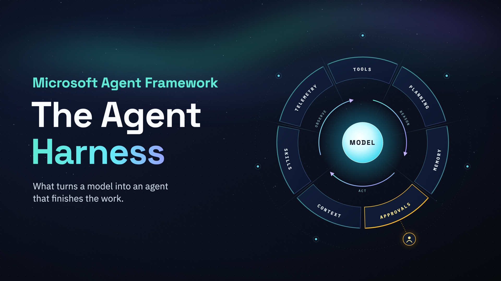
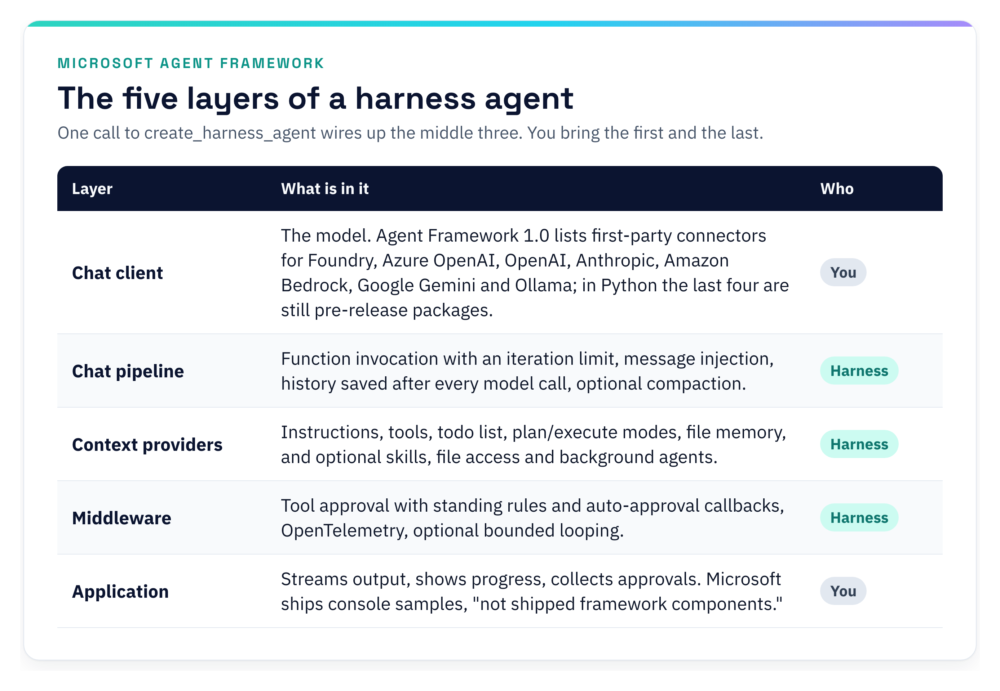
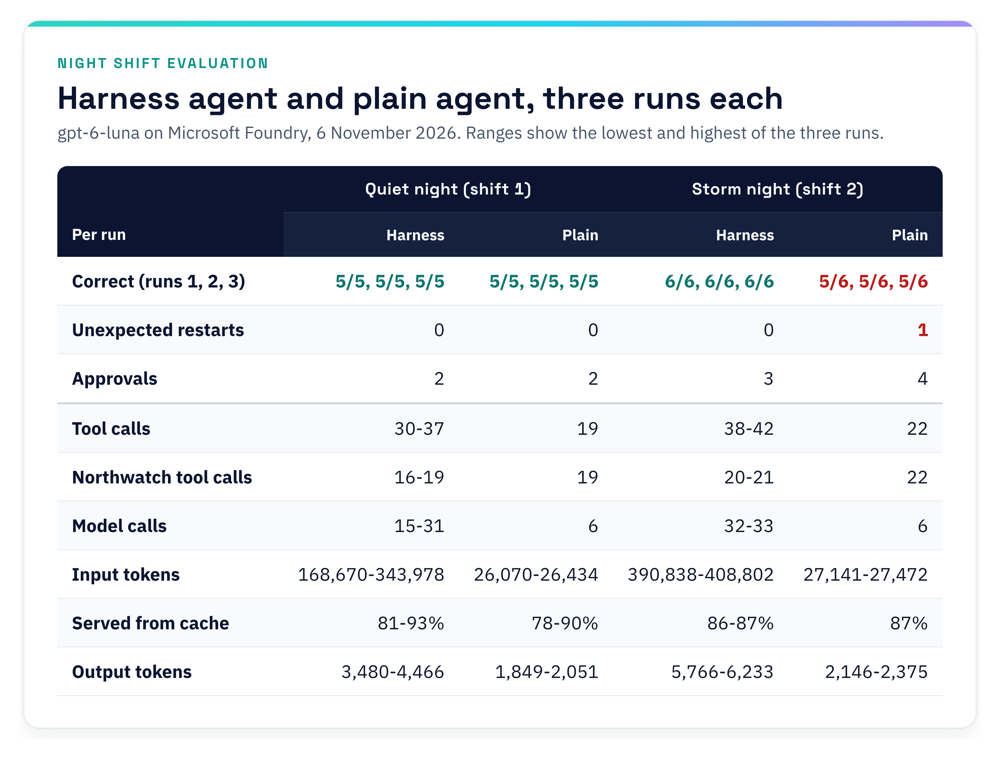
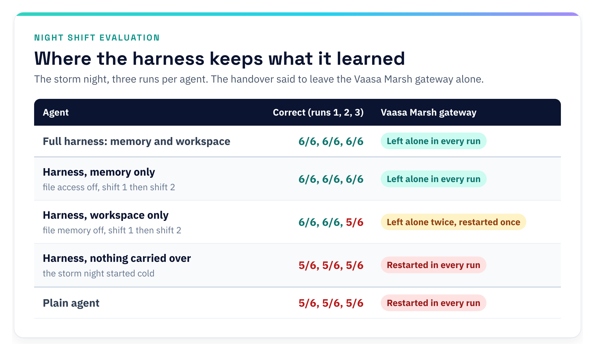

# The Agent Harness, Explained: What Microsoft Shipped and How to Build on It in Python



*What turns a language model into an agent that finishes the work, what Microsoft released in Agent Framework, and a night-shift operations agent built on it in Python: run against a live model on Microsoft Foundry, measured against a plain agent, and hosted as a Foundry Hosted Agent.*

*Working code: [nightshift-ms-harness on GitHub](https://github.com/mcekikj/nightshift-ms-harness). Everything in this article runs, and every number about Night Shift comes from those runs.*

---

**In short**

- **What a harness is.** The runtime around a language model: it executes the model's tool calls, keeps the state, enforces approvals and decides when the work is done. In a production agent such as Claude Code, it is most of the code.
- **What Microsoft shipped.** On 22 July 2026, Microsoft Agent Framework released a stable harness for Python and .NET. One call returns an agent with planning, memory, approvals, compaction and telemetry built in, and every piece can be customised or removed.
- **What the demo shows.** On a live model in Microsoft Foundry, a night-shift agent built on the harness and a plain agent both got every alert right on a quiet night. On the storm night, only the harness agent remembered the previous shift's handover and left alone a gateway it had been told not to touch, in every run. Take away the state it carries between shifts and the mistake comes back.

---

## What an agent harness is

A model answers. An agent finishes.

A language model predicts the next tokens from the tokens it was given. It does not call anything, remember anything, or know when it is done. Give it a tool schema and it will emit a well-formed tool call, but something else has to execute that call, feed the result back, decide whether to continue, keep the conversation inside the context window, pause when the next action is risky, and persist enough state that a crash at step 31 of 40 does not mean starting over.

That something else is the harness. Microsoft Learn defines it plainly: an agent harness "is the runtime scaffolding that turns a language model into an agent that can perform work. It drives model and tool calls, manages conversation state and context, applies approval policies, and can keep the agent progressing through a multistep task."

How much of a real agent is harness? In April 2026, researchers from VILA Lab at the Mohamed bin Zayed University of Artificial Intelligence published a source-level analysis of Claude Code v2.1.88, roughly 512,000 lines of TypeScript. The paper cites a community estimate that only about 1.6 percent of that codebase is AI decision logic and 98.4 percent is operational infrastructure, and the authors describe the architecture as "overwhelmingly deterministic infrastructure (permission gates, tool routing, context management, recovery logic)". Treat it as a line count, not a law; the direction is the point. If the model is the engine, almost all of the engineering is in the car around it, and the parts easiest to get wrong are the ones production depends on: stopping conditions, approvals, context and recovery.

If you have used a coding agent such as Claude Code, Codex or GitHub Copilot's agent mode, you have used a harness. Wes Steyn, a Principal Software Engineer at Microsoft who works on Agent Framework, calls such an agent a "claw": "a capable, CLI-style agent that can plan, use tools, remember things, and safely act on your behalf." Agents like these "can feel like magic," he writes, "but underneath they are an agent harness: a loop around a language model wired up with tools, planning, memory, approvals, and observability." What Microsoft has now released is that loop as a general-purpose runtime, so you can put your own domain inside it.

## What Microsoft announced

On 22 July 2026, Steyn announced on the Microsoft Agent Framework blog that the harness is released: "a stable, batteries-included harness" for Python and .NET, made of "the loop, planning, memory, context management, approvals, and telemetry that turn a model into an agent that actually does things". The post describes it as "an opinionated, fully customizable, batteries-included agent that wraps a chat client with a complete agentic pipeline, tuned for long-running, autonomous work such as research, data analysis, and general task automation."

Internally, the post explains, the harness is "just a chat-client agent" (`Agent` in Python, `ChatClientAgent` in .NET) with a curated set of Agent Framework features added, each enabled by default and each customisable or removable:

- **Function invocation**: the automatic tool-calling loop, with a configurable iteration limit.
- **Per-service-call history persistence**: chat history saved after every model call, for crash recovery and mid-run inspection.
- **Compaction**: context-window management, so long tool-calling loops do not overflow.
- **Todos and agent modes**: a persistent todo list plus plan/execute mode tracking, so the agent plans the work and then executes it.
- **File memory**: durable session notes and artifacts that survive across turns.
- **Skills**: progressive discovery and loading of packaged domain expertise.
- **Web search**: the inference service's built-in web search, where the service provides one.
- **Tool approval**: "don't ask again" standing rules plus heuristic auto-approval for safe calls.
- **Telemetry**: built-in OpenTelemetry.

Microsoft's Learn capability matrix gives the precise picture per language. In Python, skills are "opt-in through a provider or paths", and compaction, in Python as in .NET, is "Enabled when token limits or a custom strategy are supplied." Everything else on the list is on from the first call.

The division of labour is the whole idea. You supply your own chat client and "only configure what makes the agent yours", its instructions and its tools; "Everything else has a sensible default." In Python that is one call. Here is the release post's Python example, lightly condensed, with a session added (explained below):

```python
import asyncio

from agent_framework import create_harness_agent
from agent_framework.foundry import FoundryChatClient
from azure.identity import AzureCliCredential


async def main() -> None:
    # FoundryChatClient reads FOUNDRY_PROJECT_ENDPOINT and FOUNDRY_MODEL from the environment.
    client = FoundryChatClient(credential=AzureCliCredential())
    agent = create_harness_agent(
        client=client,
        agent_instructions="You are a helpful research assistant. Plan your work, then execute it.",
        tools=[],  # add your own callable tools here
    )
    session = agent.create_session()  # added: see below
    response = await agent.run("Research the outlook for renewable energy stocks.", session=session)
    print(response.text)


asyncio.run(main())
```

Four opt-in features ship with a warning for now: background agents, file access, looping, and shell tooling "from the alpha-stage tools package." You can use them today; Microsoft wants more customer feedback before it calls them released. The documentation is on Microsoft Learn, and runnable samples for both languages are in the `microsoft/agent-framework` repository on GitHub.

### How it got here

The harness is the latest step in a consolidation that began when Microsoft introduced Agent Framework in October 2025.

- **1 October 2025.** Microsoft introduces Agent Framework, which "converges AutoGen, a former Microsoft Research project, and the enterprise-ready foundations of Semantic Kernel into a unified, commercial-grade framework."
- **February 2026.** Release Candidate; the feature surface is locked.
- **2 April 2026.** Agent Framework 1.0 for .NET and Python, announced the next day with "stable APIs, and a commitment to long-term support." The Agent Harness is listed as a preview feature, "functional and available for early adoption".
- **3 June 2026, Build.** The harness is "the layer where model reasoning meets real execution". The same post introduces CodeAct in the alpha `agent-framework-hyperlight` package, which runs model-written code in a Hyperlight micro-VM; on Microsoft's benchmark it cut time from 27.81 to 13.23 seconds and tokens from 6,890 to 2,489.
- **22 June to 27 August 2026.** Steyn's four-part series "Build your own claw and agent harness with Microsoft Agent Framework" builds a personal-finance assistant in .NET and Python side by side, from tools and planning to approvals, memory, skills, CodeAct, governance and Foundry hosting.
- **22 July 2026.** The harness is released, as described above. On 4 August Steyn adds a section on when to use the basic chat-client agent instead.
- **23 October 2026.** The Learn concept page documents the harness for .NET, Python and Go, with a capability matrix and a "Use … with Harness Agent" section on every capability page.

### Why the design matters

Two design decisions explain why this matters more than yet another agent abstraction.

First, **the harness is composition, not a new runtime**. Microsoft Learn is explicit: "The Harness composes existing Agent Framework building blocks rather than defining a separate agent runtime." What `create_harness_agent` returns is a normal `Agent`, and its sessions use the same session and context-provider abstractions as any other agent. Replying under the release post, Steyn put it this way: "The Microsoft Agent Framework Harness is simply a collection of Agent Framework features that have been assembled in an opinionated way", and "each feature of the Microsoft Agent Framework Harness can be fully customized or removed entirely." You can take the harness apart, and you can start from a plain agent and add the pieces one by one. The harness just saves you from doing that for every project.

Second, **the dangerous parts are opt-in and labelled**. File access, looping, background agents and shell execution are the capabilities that produce "autonomous agent" headlines and also the ones that produce incidents. They work today, they emit an `ExperimentalWarning` when you enable them, and the documentation tells you which trust boundary each one crosses. That is an honest contract.

### What is in the box

The harness composes five layers, shown in Figure 1.



*Figure 1. The five layers of a harness agent, following the architecture on Microsoft Learn. One call to `create_harness_agent` wires up the chat pipeline, the context providers and the middleware; the chat client and the application are yours.*

In Python, `create_harness_agent(client=...)` also wires in message injection, and its file memory is scoped to the session. Compaction needs both token budgets or a custom strategy. Even the bare call prints one `ExperimentalWarning` in 1.24.0, because the default file memory is backed by the experimental `FileSystemAgentFileStore`.

One subtlety worth knowing before you build anything: because the approval middleware is on by default, **every run needs a session**. Without one, the run fails with `RuntimeError: ToolApprovalMiddleware requires an AgentSession.` That is the line added to the snippet above. Microsoft's getting-started sample creates its session with `agent.create_session()`; the shorter snippet in the release post passes none, and with `agent-framework` 1.24.0 it stops with exactly that error. The middleware keeps queued approval requests and standing approvals in session state, and, per the tool-approval documentation, an approval response counts only when it matches a pending request recorded in the same session; anything else is ignored.

## The use case: one night at Northwatch Energy

It is 03:14 at Northwatch Energy. Northwatch is fictional, but the night is not: about 400 solar-and-battery sites spread across the Nordics, one engineer on call, and an alert queue that does not care what time it is.

Five alerts are open. An inverter at Luleå South stopped with a fault code. A gateway at Vaasa Marsh has not reported since 22:21. Kiruna Ridge logged a three-second DC overvoltage. Rovaniemi Flats has a degraded capacitor bank. And the battery system that backs up the Umeå hospital has reported 100 percent state of charge for six hours while discharging 40 kW, which cannot be true.

Each of those alerts has a runbook, and every shift starts with the standing notes left by previous shifts. Each runbook starts the same way: check the site profile, run the remote diagnostic. Then it branches. A soft fault on a first occurrence gets a restart. A soft fault on a second occurrence in seven days gets a technician. A hospital backup site never gets a remote restart, whatever the fault code says. A comms loss at Vaasa Marsh between 23:00 and 02:30 is a known carrier problem with an open ticket, and dispatching a technician for it would waste a night and a few hundred euros.

None of this is hard. All of it is tedious, repetitive, and consequential if you get one step wrong at three in the morning. It is also exactly the shape of work that a language model with tools should be able to do, and exactly the shape of work where "a language model with tools" is not enough.

That missing part is the harness. In the rest of this article I build Northwatch's overnight agent on Microsoft's harness, in Python. I run it against a live model on Microsoft Foundry, measure it against a plain agent, host it as a Foundry Hosted Agent, and report what I learned.

## Build the Night Shift agent

The demo is about 1,900 lines of Python. The harness composition itself is one 58-line function in `nightshift/agent.py`; the rest is the simulated world and its scoring, the tools, the approval loop, the console, the evaluation and a recovery drill. Let me walk through the pieces in the order they matter.

### Tools carry their own risk level

Night Shift has seven tools. Four only read: the alert queue, the site profile, telemetry and the remote diagnostic. One closes an alert. Two change the world, and one of them costs money. The approval requirement sits on the tool, not on the agent, so it holds for any agent that ever picks the tool up. Two of the seven, from `nightshift/tools.py`:

```python
@tool(name="run_remote_diagnostic", approval_mode="never_require")
def run_remote_diagnostic(
    site_id: Annotated[str, "Site id, for example S-114."],
    device_id: Annotated[str, "Device id at that site, for example INV-02 or GW-01."],
) -> dict[str, Any]:
    """Run the remote self-test on a device: fault classification, measurements, carrier status and whether a restart is safe. Read-only."""
    return _safe(world.diagnostic, site_id, device_id)

@tool(name="restart_device", approval_mode="always_require")
def restart_device(
    site_id: Annotated[str, "Site id, for example S-114."],
    device_id: Annotated[str, "Device id to restart, for example INV-02 or GW-01."],
    reason: Annotated[str, "One-line justification shown to the approver."],
) -> dict[str, Any]:
    """Remotely restart an inverter or gateway. Risky: interrupts the device, subject to site policy and operator approval."""
    return _safe(world.restart, site_id, device_id, reason)
```

The `reason` argument is deliberate. When the harness pauses for approval, the request carries the function name and its arguments, so the operator sees the model's one-line justification. It is the cheapest audit trail you will ever get.

Policy is also enforced inside the tool. A restart at a site whose profile says `remote_restart_policy: never` is refused by the world even after a human approved it. Human approval is one gate; the tool's own policy check is a second.

### Two layers of instructions

The harness separates *how any of our agents work* from *who this agent is*. Harness instructions go first, agent instructions second. Night Shift extends Microsoft's default harness guidance with an operating standard that every Northwatch agent would share:

```python
OPERATING_STANDARD = (
    DEFAULT_HARNESS_INSTRUCTIONS
    + """
## Northwatch operating standard (applies to every Northwatch agent)

- Verify before you conclude. Every statement about a site or a device must come from a tool result obtained in this session.
- Read-only first. List, profile, diagnose and read telemetry before any action that changes state.
- Risky actions (restarting a device, dispatching a technician) always go through approval. Request them with a one-line reason. Never describe an action as done unless the tool returned success.
- If an approval is denied or a tool refuses, adapt: take the next safest option from the runbook and say what you did.
- Keep the todo list current: one item per alert, plus one for the shift report. Mark items complete as you go.
- Be concise. Between tool calls, say in one or two sentences what you learned and what you will do next.
"""
)
```

The agent instructions describe the NOC, the resolution taxonomy, four hard rules and the workflow of a shift. They never mention a fault code. The fault codes live in runbooks, and runbooks are skills.

### Runbooks as skills

Agent Skills are directories with a `SKILL.md` file: YAML front matter with a name and a description, then the instructions. The agent is shown only the names and descriptions; when a task matches, it calls `load_skill` to pull the full text into context. Night Shift ships four: inverter alerts (faults and DC overvoltage), communication loss, battery anomalies and the shift report format. Here is the inverter runbook's front matter and three rows of its decision table:

```markdown
---
name: inverter-fault-triage
description: Runbook for inverter alerts (kind "inverter_fault" with codes F-27, F-41 and others, and kind "dc_overvoltage"). Load it whenever an open alert concerns an inverter before deciding on a restart or a dispatch.
---
…
| Condition | Action | Resolution |
| --- | --- | --- |
| `critical_load` is set, or `remote_restart_policy` is `never` | Never restart remotely. `dispatch_technician` with priority `urgent`. | `dispatched` |
| F-27 (DC link soft fault), `safe_to_restart` true, first occurrence in 7 days | Request `restart_device` (this needs approval). After the restart, call `get_telemetry` and confirm `state` is `running`. | `restarted` |
| F-27 second or later occurrence in 7 days | Do not restart again. `dispatch_technician`, priority `next-business-day`. | `dispatched` |
```

Skills keep each runbook out of the prompt until an alert needs it. In a demo this size, that buys less than you might think. The four runbooks add up to about 1,600 tokens (at four characters per token), while the harness adds its own operating instructions and 25 tool schemas of its own: its first request carries 32 tools, the plain agent's carries 7. Measured on the first model call of a shift, the harness agent starts at about 6,600 input tokens and the plain agent, with every runbook inlined, at about 2,600. With four small runbooks, skills buy relevance, not a smaller prompt; the saving arrives when the library is large. In the console run below, the agent called `load_skill` four times, once per runbook, and kept the inverter runbook in context for all three inverter alerts.

### The one call

Condensed from `nightshift/agent.py`:

```python
agent = create_harness_agent(
    client=client,
    name="nightshift",
    harness_instructions=OPERATING_STANDARD,
    agent_instructions=NOC_INSTRUCTIONS,
    tools=build_tools(world),

    # planning: one todo per alert; start in plan mode so the operator approves the plan
    todo_provider=TodoProvider(),
    mode_provider=AgentModeProvider(default_mode="plan"),

    # keep working while todos remain in execute mode, at most 12 passes per run
    loop_should_continue=todos_remaining(looping_modes=["execute"]),
    loop_next_message=todos_remaining_message,
    loop_max_iterations=12,

    # a NOC wants one notebook shared by every shift, not one per session
    disable_file_memory=True,
    context_providers=[FileMemoryProvider(FileSystemAgentFileStore(".nightshift/memory"), scope="noc-nordic",
                                          instructions=MEMORY_INSTRUCTIONS)],

    # runbooks are ours, loading them does not need a human
    skills_provider=SkillsProvider.from_paths("skills", disable_load_skill_approval=True,
                                              disable_read_skill_resource_approval=True),

    # the shift report is written here
    file_access_store=FileSystemAgentFileStore("workspace"),
    auto_approval_rules=[
        FileAccessProvider.read_only_tools_auto_approval_rule,  # reading the workspace never needs a human
        approve_report_writes,                                   # writing under reports/ does not either
    ],

    # compaction: both budgets switch on a context-window strategy in the history pipeline
    max_context_window_tokens=128_000,
    max_output_tokens=16_384,

    disable_web_search=True,              # a NOC does not browse
    default_options={"store": False},     # keep history in-process so persistence and compaction apply
)
```

A few of these lines deserve a sentence each.

**Memory scope.** The default file memory is scoped to the session: every new conversation starts with an empty notebook. That is the right default for a personal assistant and the wrong one for a NOC. Building the provider yourself with a stable `scope` gives every shift the same `site-notes.md`. Microsoft's docs are precise about it: treat the scope "as one opaque namespace key, not as a file-system path." Replace the instructions as well. The provider's default text tells the model it has "a session-scoped, file-based memory system" whose files "are isolated from other sessions", which stops being true the moment you share the scope; Night Shift's version says the notebook is shared by every shift and asks the agent to clean up its per-shift working files.

**Auto-approval rules.** File-access tools require approval by default; an auto-approval rule relaxes that call by call, and the `file_access_disable_*_tool_approval` flags switch it off. Microsoft ships a rule for the read-only ones (read, read lines, list, grep). The second rule is seven lines of my own: approve `file_access_write`, `file_access_replace` and `file_access_replace_lines` when the target starts with `reports/`; deletes still ask. Rules are evaluated in order and, in Steyn's words, "the first to return true wins." They match on the tool name, so a different local tool with the same name would also pass. Keep the names unique.

**The loop.** In Microsoft's words, "todo tracking records progress but doesn't by itself re-invoke the agent." `todos_remaining(looping_modes=["execute"])` turns the harness into something that keeps going until the list is empty, and only in execute mode, so planning stays interactive. The harness places the loop outside the approval middleware, which is the detail that makes autonomy safe: when an iteration hits a tool that needs approval, the request escapes the loop and comes back to you. No further autonomous pass runs until you answer.

**`store: False`.** The Responses API stores conversation state server-side by default, and the compaction docs list such service-managed state as something compaction cannot touch. Run the release example above and the harness says so itself: it logs that it is skipping the local history load. With `store=False` the transcript lives in the harness's own history provider, which is where per-call persistence and compaction work. Microsoft's hosting layer makes the same move: in its default mode it disables downstream service storage "to prevent duplicate history."

### Answering approvals

The caller owns the approval conversation. A run that needs a decision returns `user_input_requests` instead of a final answer; you answer in the same session and the agent continues. In simplified form (the real `run_turn` in `nightshift/approvals.py` also streams the output and records each approval):

```python
async def run_turn(agent, session, user_input, approver):
    current = user_input
    while True:
        response = await agent.run(current, session=session)
        requests = [r for r in response.user_input_requests if r.function_call is not None]
        if not requests:
            return response
        replies = []
        for request in requests:
            decision = await approver(request)           # a terminal prompt, or a policy
            replies.append(Message("user", [response_for(request, decision)]))
        current = replies
```

`response_for` is where standing approvals come from. Answer with `request.to_function_approval_response(True)` and you approve this call. Answer with `create_always_approve_tool_response(request)` and the harness records a rule in the session: never ask me about this tool again. There is a variant for "this tool with exactly these arguments." The rules live in session state, so they expire with the session and travel with it if you serialise it.

### Telemetry is built in, and measurable

Instrumentation is on by default; you choose where the signal goes. For a Foundry project it is one line, `await client.configure_azure_monitor()`, which takes the Application Insights connection string from the project. The project needs an Application Insights resource connected; mine had none, so I connected an existing one first. For local work, `configure_otel_providers()` reads the standard `OTEL_*` variables and talks to an Aspire dashboard or any OTLP collector.

The demo uses the same signal to measure itself. A 49-line `SpanProcessor` attached to the global tracer provider counts `chat` spans (model calls, with input, cache-read and output tokens from the `gen_ai.usage.*` attributes), `execute_tool` spans per tool name, and `invoke_agent` spans. No separate accounting, no guessing from the transcript.

## Run a shift

This is the console on `gpt-6-luna`, lightly trimmed. For the recording, a policy answered the approvals (`--approve auto`); run it without that flag and each approval stops at a prompt: approve, deny, always approve this tool, or always approve these exact arguments.

```
$ python run_shift.py --scenario shift-01 --approve auto

Night Shift · Quiet Tuesday (shift-01)
  model: foundry:gpt-6-luna   telemetry: foundry   mode: plan   approvals: auto
  memory: on   skills: on   file access: on   loop: on, max 12
  open alerts: 5   session: 504284cf-…

nightshift> I’ll first check the shared site notes and the current open-alert queue. In plan mode I’ll then
create one work item per alert plus the shift report, and present the plan for your approval before taking
any operational action.
  ▶ file_memory_ls({})                                    ◀ []
  ▶ file_memory_read({"file_name":"site-notes.md"})      ◀ File 'site-notes.md' not found.
  ▶ list_open_alerts({})                                  ◀ [{"alert_id": "A-1001", "site_id": "S-118", ...
  ▶ todos_add({"todos":[{"title":"Triage and resolve A-1001 at S-118", ...
  ▶ file_memory_write({"file_name":"shift-01-plan.md", ...
Plan for shift-01:
- Triage and resolve A-1001, A-1003, and A-1004 using the inverter runbook.
- Triage and resolve A-1005 using the battery runbook.
- Triage A-1002 using the comms runbook. Its S-207 alert opened during the handed-over NW-07 congestion
  window; I’ll honor the no-dispatch instruction and note CAR-55120 and the recurring outage in the report.
- Verify before resolving each alert, and request approval for any restart or dispatch.
- After the alerts are handled, write `reports/shift-01.md` and update `site-notes.md` with the durable
  S-207 handover.
I’ve added these six todos and saved the working plan. May I switch to execute mode and process the queue?

operator> /go
nightshift> I’ll switch to execute mode and begin with the oldest alert.
  ▶ mode_set({"mode":"execute"})
  ▶ load_skill({"skill_name":"inverter-fault-triage"})
  ▶ get_site_profile({"site_id":"S-118"})                 ◀ {... "remote_restart_policy": "allowed" ...
  ▶ run_remote_diagnostic({"site_id":"S-118","device_id":"INV-02"})
                                                           ◀ {... "fault_code": "F-27", "classification": "soft fault" ...
S-118 has no critical load, restart policy is allowed, and INV-02’s diagnostic identifies a safe,
first-in-seven-days F-27 soft fault. I’ll request the runbook-approved restart; if approved, I’ll check
telemetry before resolving A-1001.

  ⏸  Approval needed: restart_device(site_id='S-118', device_id='INV-02', reason='A-1001: first F-27 soft
     fault in 7 days; diagnostic says safe to restart and site policy allows it.') -> approved (policy)
  ▶ restart_device(...)                                    ◀ {"status": "completed", ...
  ▶ get_telemetry({"site_id":"S-118","device_id":"INV-02"}) ◀ {... "state": "running" ...
  ▶ resolve_alert({"alert_id":"A-1001","resolution":"restarted", ...
  ▶ todos_complete({"items":[{"id":1, ...
  ▶ load_skill({"skill_name":"comms-loss-triage"})
  ▶ get_site_profile(...)   ▶ run_remote_diagnostic({"site_id":"S-207","device_id":"GW-01"})
A-1002 matches the handover: the gateway alert opened inside S-207’s recurring 23:00–02:30 NW-07
congestion window, and CAR-55120 remains open. The runbook directs no action for a standing note with an
open carrier ticket, so I will not restart or dispatch; I’ll resolve it as a known issue and include the
ticket in the report.
  ▶ resolve_alert({"alert_id":"A-1002","resolution":"known_issue", ...
  ...
  ⏸  Approval needed: dispatch_technician(site_id='S-142', priority='next-business-day', reason='A-1004:
     INV-05 F-41; diagnostic confirms degraded capacitor bank out of tolerance and unsafe to restart.')
     -> approved (policy)
  ▶ dispatch_technician(...)                               ◀ {"status": "ticket_created", "ticket": "FT-0015", ...
  ...
  ▶ load_skill({"skill_name":"shift-report"})
  ▶ file_access_write({"file_name":"reports/shift-01.md", ...
  ▶ file_memory_write({"file_name":"site-notes.md", ...
The shift report and durable S-207 note have been written. I’ll verify both saved files, then mark the
final todo complete and remove the temporary working plan so only the enduring handover remains in memory.
  ▶ file_access_read(...)   ▶ file_memory_read(...)   ▶ file_memory_delete({"file_name":"shift-01-plan.md"})
Shift-01 complete: all five open alerts were resolved.
```

The console's `/score` and `/metrics` commands then reported five correct resolutions out of five, no unsafe restart attempts, 36 tool calls, 23 model calls and two approvals in 84.9 seconds.

Four things happened in that transcript that a model with tools would not have done on its own. It wrote the plan down before it did anything, and waited. Its approvals were filtered by policy: it stopped for the two actions that change a site, while reading the workspace and writing the report went through on auto-approval rules. It saved the handover note in `site-notes.md` so that tomorrow's shift inherits it, and deleted its working plan so that the notebook holds only what the next shift needs. And it ended with a report in the workspace that is better than most of the ones I have written at six in the morning. A report and a memory file from the evaluation runs are in the repository next to this article.

## Measure it

The repository includes `evaluate.py`, which runs the scenarios headless with a policy that approves every request, so the numbers reflect the agent's judgement rather than the operator's. It scores each run against the ground truth that ships with the scenario: the resolution of every alert, and every restart and dispatch, with its site and its priority. Two agents take part:

- **harness**: everything above, started in execute mode.
- **plain**: the same model, the same seven tools, the same operating standard and the same domain knowledge (all four runbooks inlined into the prompt, since there is no skills provider), built with a plain `Agent`. Its prompt says that it has no file tools and no memory.

Shift 2 is the storm night. It contains a repeat of the Vaasa Marsh comms loss (the handover note from shift 1 says not to dispatch), a second F-27 on the Luleå inverter (the runbook says do not restart twice, dispatch), two overvoltage events on one Kiruna inverter (two in a shift means a site visit) and a soft fault at the hospital backup site (never restart remotely). It is designed to punish an agent that has no memory and no patience.

Model for both: `gpt-6-luna` (Global Standard) on a Microsoft Foundry project in Sweden Central. Each agent worked both shifts three times on 6 November 2026, with the code as published. Model calls, tool calls and tokens come from Agent Framework's own OpenTelemetry spans (`chat` and `execute_tool`); correctness and restarts are scored against the scenario's ground truth, and approvals are counted by the approver. Figure 2 shows the results.



*Figure 2. The harness agent and the plain agent on both nights, three runs each. The harness agent made no more calls to Northwatch's own tools than the plain agent; the rest of its tool calls were its own todo, skill, memory and file operations.*

No agent made an unsafe restart attempt, repeated a restart, missed a restart or a dispatch, dispatched twice for one site or chose the wrong priority, in any run. The harness agent wrote the shift report to the workspace every time; the plain agent has no file tools and gives its report in the final answer. Wall-clock time is left out because the runs shared the deployment with the other jobs described below; a harness shift took one to two minutes, a plain one under half a minute.

On the quiet night both agents are perfect in every run, and the plain agent is the bargain: six model calls instead of 15 to 31, and about 26,000 input tokens instead of 169,000 to 344,000. Left alone, `gpt-6-luna` issues several tool calls per model turn. The harness's default instructions ask it to avoid "more than 4 tool calls in a row without explaining what you are doing", my operating standard asks for a sentence between tool calls on top of that, and the harness's todo, mode, skill and memory tools add round trips of their own. On a night like that, the plain agent is the right tool, which is exactly Microsoft's own advice: the basic chat-client agent is there for simple jobs.

The storm night is where the difference lives, and it lives in exactly one place: state the model does not have.

**Memory.** The Vaasa Marsh gateway alert came back at 23:12. In all three runs the plain agent did what the runbook says to do when there is no carrier incident and out-of-band access works: it asked to restart the gateway, got the approval, and the gateway came back. Its audit note from the third run is a small masterpiece of being wrong for the right reasons: "Restarted gateway GW-01 after confirming no carrier incident and out-of-band reachability; telemetry verified state online." The previous night's handover ("Do not dispatch anyone for S-207 comms loss during that window, just note it in the report") lived in a conversation the plain agent no longer had, and in two of its three reports it said so itself: "Prior-shift `site-notes.md` could not be accessed; no memory file or report-writing tool was available in this session."

The harness agent had saved the handover in `site-notes.md` during shift 1 and read its memory again on shift 2. In all three runs it closed the alert as a known issue without touching anything, citing a carrier ticket that appears nowhere in the storm night's alerts, diagnostics or handover. From the second run: "S-207 GW-01 loss occurred during the documented NW-07 congestion window; carrier ticket CAR-55120 remains open through 2026-11-11. No restart or dispatch per standing note."

**Where the state lives.** The harness gives the agent two places to carry state from one night to the next: the file memory, and the file-access workspace where shift 1 leaves its report. To see which one mattered, I ran three more variants of the harness agent, three runs each, and set them next to the full harness and the plain agent in Figure 3.



*Figure 3. What carried the handover from one night to the next. The file memory alone was enough in every run, the workspace alone only when the agent improvised a notebook in it, and with nothing carried over the harness agent made the plain agent's mistake.*

The notebook is the dependable channel. With memory alone the agent got the gateway right every time. With the workspace alone it got it right only when it improvised a notebook there: in two runs it wrote `site-notes.md` into the workspace during shift 1, and because that path is outside `reports/`, the harness stopped and asked for approval before the write. In the third run it saved only the report, and restarted the gateway the next night. Started cold, it made the plain agent's mistake every time, with the plain agent's reasoning: "GW-01 had out-of-band reachability and no carrier incident; remote restart completed and telemetry confirms the gateway is online." Todos, modes, skills and approvals do not carry knowledge from one night to the next. The notebook does.

**Everything else was a draw**, and that is worth saying plainly. In every run, every agent dispatched for the repeat F-27 at Luleå, dispatched urgently for the hospital backup site without asking to restart it, recognised the carrier incident at Rovaniemi, and turned the double overvoltage at Kiruna into a single site visit. Across all 27 runs, counting both shifts, no agent ever asked to restart a device that its site policy or its diagnostic ruled out. At a site whose policy forbids remote restarts, the tool would have refused even after an approval.

I did not get there on the first attempt, and every fix taught me something about the evaluation rather than the agent. My first runs exposed a rule that lived only in my ground truth (the plain agent escalated the Kiruna alert with "No specific runbook for DC overvoltage", and it was right), a `reports/` rule that missed `file_access_replace`, a scorer that marked a sensible combined dispatch as wrong, and a results table that counted tool calls from the response stream instead of the spans. A second look found three more: my first memory-off ablation started the storm night cold, so it removed the notebook and the workspace at once; my scorer never checked dispatch priorities or whether a "restarted" alert had really been restarted; and I had shared the memory scope but kept the provider's default instructions, which told the model its notes were "isolated from other sessions". All of it is fixed, and every number above comes from the fixed code.

Evaluate your evaluator before you evaluate your agent.

The price of the full harness on the storm night: it read 14 to 15 times the plain agent's input tokens. Azure's prompt cache served 86 to 87 percent of that, about the same share as for the plain agent, so its uncached input was also 14 to 15 times the plain agent's, and its output 2.5 to 2.9 times. The domain work was not the difference: the harness agent made 20 or 21 calls to Northwatch's tools against the plain agent's 22, and 16 to 19 against 19 on the quiet night. The rest, 17 to 22 calls a run on the storm night, were the harness's own todo, skill, memory and file calls, and each of its 32 or 33 model calls re-read a growing transcript. For a decision that keeps an agent from acting on a site it was told to leave alone, the arithmetic is not close. For a workload where nothing carries over between runs, it might be.

That bill is not fixed. As Steyn says, every feature can be customised or removed, and the Python factory has a switch for most of them: `disable_todo` and `disable_mode` take out the todo list and the plan/execute modes, `harness_instructions` replaces the default operating guidance, and memory, skills and file access are separate providers you add or leave out. The memory-only variant above is one leaner configuration, already measured: on the storm night it got every decision right with 29 to 48 percent fewer input tokens than the full harness, paired run by run, and 55 to 60 percent fewer uncached ones. For the main runs I kept the defaults, apart from web search, and added the opt-in features the job needed, because I wanted to measure the full package rather than a tuned one.

Numbers like these are the reason to measure before you argue. The harness does not make the model smarter. It makes the run governable, resumable and inspectable, and it gives the model a place to put what it learned. Whether that is worth the extra tokens is a question each workload answers differently, and now it is a question you can answer with a script.

## Take it to Azure

Nothing in the demo is Azure-specific until you want it to be, and then two things are.

**Foundry as the model and trace backend.** A Microsoft Foundry project gives you the model deployment, Entra ID authentication (`az login` locally, managed identity in production) and, once Application Insights is connected, a home for the harness's `invoke_agent`, `chat` and `execute_tool` spans with token counts per call. Point the demo at a project with `NIGHTSHIFT_PROVIDER=foundry` and `NIGHTSHIFT_TELEMETRY=foundry`; the chat client reads the Application Insights connection string from the project itself.

**Foundry Hosted Agents as the runtime.** Microsoft Foundry Hosted Agents is generally available; the Python `agent-framework-foundry-hosting` integration is still pre-release. The same factory runs behind Foundry's Responses protocol. `hosted.py` wraps it in `ResponsesHostServer` with `history_source="agent"`, so the host's session store persists the state carried by the `AgentSession`: the transcript, todos, mode and standing approvals. It switches to managed identity and keeps memory under the home directory, which the platform "persists … across turns and idle periods." That persistence is per session: every hosted session gets its own sandbox and `$HOME`, so the cross-shift notebook from the console does not carry over between hosted sessions as built. For one notebook shared by every shift, back the `FileMemoryProvider` with an external `AgentFileStore`.

`hosted.py` also turns file access off, following Microsoft's own production sample: in a shared hosted environment, giving the model arbitrary read and write access to the container filesystem "is a serious security risk", and an external `AgentFileStore`, for example one backed by Azure Blob Storage, is the way to bring it back. Foundry injects `APPLICATIONINSIGHTS_CONNECTION_STRING`, so there is no exporter code at all. On history, Microsoft's sample takes the other documented route: the host's default `history_source="agent_server"` with `InMemoryHistoryProvider(load_messages=False)`, so the host owns the transcript. I chose `"agent"` to keep the transcript, and compaction with it, in the harness.

With the Azure Developer CLI and its `azure.ai.agents` extension installed, deployment took two commands and no Docker: `azd ai agent init` against the existing project (code deploy: a ZIP, with dependencies resolved remotely from `requirements.txt`) and `azd deploy`, which finished in three and a half minutes. The agent got its own Entra identity and a dedicated endpoint.

The first successful request came back with the reasoning, two tool calls and the summary as Responses output items, and the spans were already in Application Insights under the container's role name. Microsoft's documentation adds what I did not test myself: each session runs in its own VM-isolated sandbox, an idle agent scales to zero and resumes with its files intact, and Foundry can publish the agent to Teams and Microsoft 365, bridging the Responses protocol to the Activity protocol, or expose it to other agents over A2A.

Approvals survive the trip. Over the Responses protocol, a pending `restart_device` call comes back to the caller as an `mcp_approval_request` output item carrying the tool name and arguments. The caller answers with an `mcp_approval_response` and `previous_response_id` in the next request; I tested exactly that against the deployed agent: the restart ran, the agent verified telemetry and resolved the alert. The human stays in the loop; only the transport changed.

## When a run is interrupted

History is saved after every model call, and a tool's result is saved together with the model call that carries it. That leaves one seam. When my deployment was being throttled, a request failed right after a tool had run, and every later request in that session was refused with "No tool output found for function call": the session held the model's function call but no result for it.

The console now repairs the session by inserting a placeholder result after each such call, telling the model that the outcome is unknown and that it should check before acting again. The repository's `recovery_drill.py` reproduces the failure on a live deployment by answering model requests with HTTP 429 right after a tool has run. In every run I made against `gpt-6-luna`, four so far, the unrepaired session was rejected with exactly that error; after the repair, the agent re-ran its diagnostics before acting and finished the shift five out of five. If you host the harness yourself, consider persisting tool results as soon as they exist, and give the deployment enough tokens per minute that you rarely need the repair.

## A checklist for building on the harness

1. **Pass a session on every run.** Approvals, standing rules, todos and modes live in session state, and without a session the run fails.
2. **Put the approval on the tool.** `approval_mode="always_require"` travels with the function. Disabling the harness's approval middleware does not remove it; it only removes the queueing, the standing rules and the auto-approval callbacks.
3. **Auto-approval rules match by name.** Keep tool names unique, and use `tool_name_prefix` when you have more than one file-access provider.
4. **Treat memory scope as a design decision.** Session-scoped is the safe default; a stable scope is what makes an agent learn across runs. If you change the scope, change the provider's instructions too, and when hosted, use a store that outlives the session.
5. **Write the plan before the work.** Plan mode creates todos, asks and waits; `set_agent_mode(session, "execute")` from your application is the switch.
6. **Bound every loop.** `loop_max_iterations` defaults to 10. The function-invocation layer has its own limits: `max_iterations` (40 model round trips per request by default), `max_function_calls` and `max_duration_seconds` (both unset by default). Set them on purpose.
7. **Compaction only works on history you own.** Use `store: False` locally and `history_source="agent"` when hosted. The docs say not to combine the host's default `history_source="agent_server"`, or `"service"`, with a history provider that loads messages, and the harness's default provider does.
8. **Skills keep the prompt focused, not the run cheap.** Loading a runbook is a tool call, and the runbook then sits in context for the rest of the session unless you add the experimental `UnloadSkillsCompactionStrategy`. The win is relevance: the battery runbook is only there when there is a battery alert.
9. **Experimental means experimental.** File access and looping emit a warning for a reason, and so does `FileSystemAgentFileStore`. Keep write approval on unless the store boundary and the inputs are trusted, or scope it narrowly, as the `reports/` rule does.
10. **Measure with the spans you already have.** Agent Framework emits GenAI semantic-convention spans as soon as an OpenTelemetry SDK tracer provider is installed, with or without an exporter. A small `SpanProcessor` turns them into an evaluation harness.
11. **Mind the seam between a tool and the next model call.** If the call that should carry a tool's result fails, the session needs repair before it can continue (see "When a run is interrupted").

## When the harness is the right tool

Use the harness when the work is long, multi-step, touches systems that matter, and has to be explainable afterwards: when you need a plan a human can approve, actions that stop at a gate, a notebook that outlives the conversation, and a trace of every step. That describes most operational work, and most of the work that is still done by hand at three in the morning.

Microsoft is just as clear about when you do not need it. The chat-client agent "is a very basic experience" on purpose: "Use this if you want to build something simple or want to fully customize the agent." Asked under the release post when to use the harness instead of embedding the GitHub Copilot SDK, Steyn was direct: "if the Copilot SDK/CLI already solves your use case, then use it."

Agent Framework can also run the GitHub Copilot SDK as an agent backend, one of the integrations Microsoft moved from preview to release at Build 2026, and its 1.0 announcement lists Claude Code as a preview harness for its orchestrations. If your team is TypeScript-only, note that the Learn documentation covers .NET, Python and Go.

What Microsoft shipped in July is not a smarter model. It is the part of every serious agent that teams would otherwise build by hand: the loop, the plan, the notebook, the gate and the flight recorder, assembled, in Steyn's words, "in an opinionated way", released with stable APIs in Python and .NET, and open to replacement piece by piece. Night Shift needed one call to get all of it, and the one decision that separated it from a plain agent came from a note it had written to itself the night before.

To try it, clone the repository, point `.env` at a Foundry project and run `python run_shift.py`. The evaluation and the recovery drill run against the same deployment.

## References

1. Microsoft Learn, *Agent Harness* (Agent Framework concepts), dated 23 October 2026, last updated 28 October 2026. learn.microsoft.com/agent-framework/concepts/harness
2. Wes Steyn, *The Microsoft Agent Framework Harness is now released*, Microsoft Agent Framework blog, 22 July 2026, updated 4 August 2026 with the section "Basic Chat Client Agent vs Harness Agent", including the author's replies in the comments (4 and 31 August 2026).
3. Wes Steyn, *Build your own claw and agent harness with Microsoft Agent Framework* (22 June 2026) and its parts: *Meet your agent harness and claw* (22 June 2026), *Agent Harness: Working with your data, safely* (29 June 2026), *Agent Harness: Scaling the claw or harness capabilities* (9 July 2026), *Agent Harness: Making your claw production-ready* (27 August 2026). Microsoft Agent Framework blog.
4. Shawn Henry, *Microsoft Agent Framework at BUILD 2026: Agent Harness, Hosted Agents, CodeAct, and more*, Microsoft Agent Framework blog, 3 June 2026.
5. Shawn Henry, *Microsoft Agent Framework Version 1.0*, Microsoft Agent Framework blog, 3 April 2026.
6. Yina Arenas, *Introducing Microsoft Agent Framework*, Microsoft Azure Blog, 1 October 2025.
7. Microsoft Learn, Agent Framework documentation (dated 22 and 23 October 2026): *Planning and Todos*, *Agent Looping*, *Using function tools with human in the loop approvals*, *Compaction*, *Context Providers*, *Agent Skills*, *Web Search*, *Observability*, *Foundry Hosted Agents*. Microsoft Learn, *Hosted agents in Foundry Agent Service* (dated 19 October 2026).
8. microsoft/agent-framework on GitHub: `python/samples/02-agents/harness` and `python/samples/01-get-started/06_agent_harness.py`. Packages `agent-framework-core` 1.24.0, `agent-framework-foundry` 1.16.0, `agent-framework-openai` 1.18.0 and `agent-framework-foundry-hosting` 1.0.0b261030 on PyPI.
9. Jiacheng Liu, Xiaohan Zhao, Xinyi Shang, Zhiqiang Shen, *Dive into Claude Code: The Design Space of Today's and Future AI Agent Systems*, arXiv:2604.14228 (first version 14 April 2026), VILA Lab, Mohamed bin Zayed University of Artificial Intelligence, and University College London; repository VILA-Lab/Dive-into-Claude-Code.
10. Night Shift source: https://github.com/mcekikj/nightshift-ms-harness

*Northwatch Energy, its sites, alerts, runbooks and people are fictional. The model, the framework and the harness are real.*
